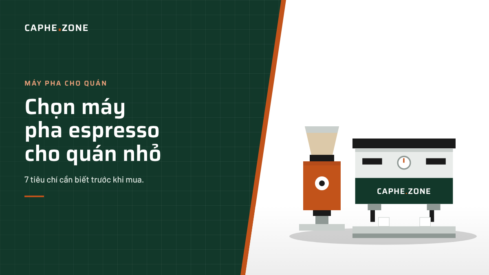
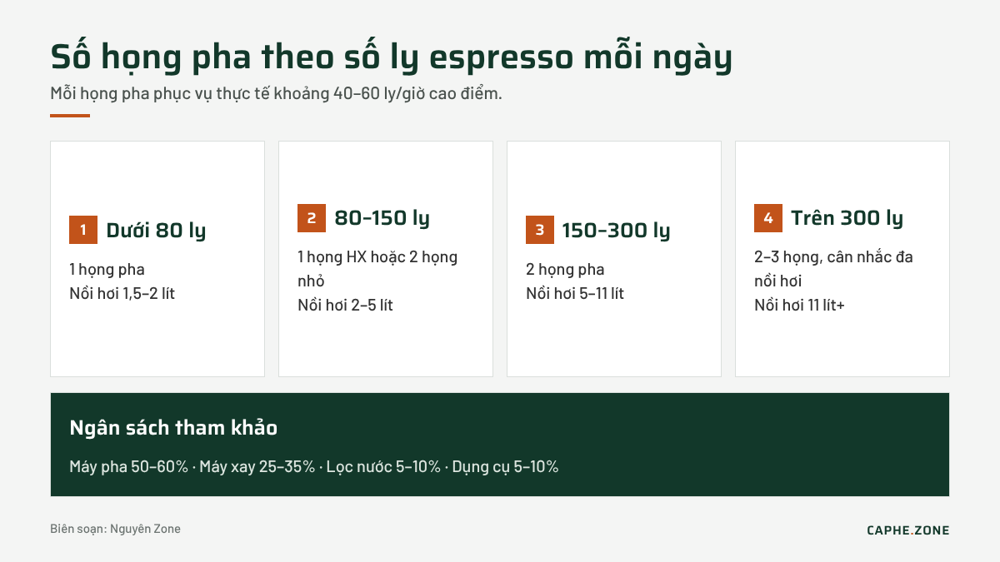

# Chọn máy pha espresso cho quán cà phê nhỏ: 7 tiêu chí cần biết trước khi mua

**Trả lời nhanh:** Quán nhỏ bán dưới 150 ly espresso mỗi ngày thường chỉ cần máy 1 họng pha, nồi hơi trao đổi nhiệt (HX) từ 1,8 lít trở lên, chạy điện 220 V một pha. Từ 150 đến 300 ly/ngày nên chọn máy 2 họng. Máy xay đi kèm quan trọng không kém máy pha: nên dành khoảng 25–35% ngân sách thiết bị cho máy xay.

Nhiều người mở quán lần đầu chỉ nhìn vào thương hiệu hoặc giá của máy pha. Thực tế, một chiếc máy phù hợp phải khớp với lượng khách, mặt bằng, nguồn điện và tay nghề của nhân viên. Bài viết này tổng hợp 7 tiêu chí mà đội kỹ thuật Caphe.Zone thường hỏi khách trước khi tư vấn.

## 1. Quán bán bao nhiêu ly mỗi ngày?

Đây là câu hỏi đầu tiên vì nó quyết định số họng pha (group). Mỗi họng pha một lượt mất khoảng 25–30 giây chiết xuất, cộng thêm thời gian xay, nén, lắp tay cầm và vệ sinh. Trong giờ cao điểm, một họng pha thực tế làm được khoảng 40–60 ly mỗi giờ.

| Số ly espresso/ngày | Số họng pha gợi ý | Dung tích nồi hơi tham khảo |
|---|---|---|
| Dưới 80 ly | 1 họng | 1,5–2 lít |
| 80–150 ly | 1 họng (HX) hoặc 2 họng nhỏ | 2–5 lít |
| 150–300 ly | 2 họng | 5–11 lít |
| Trên 300 ly | 2–3 họng, cân nhắc đa nồi hơi | 11 lít trở lên |

Nếu menu của quán có nhiều món sữa (latte, cappuccino, bạc xỉu), hãy chọn nồi hơi lớn hơn một cấp vì đánh sữa liên tục làm tụt áp hơi rất nhanh.

## 2. Nên chọn kiểu nồi hơi nào?

Có ba kiểu phổ biến:

- **Nồi hơi đơn (single boiler):** rẻ, nhỏ gọn nhưng phải chờ chuyển nhiệt giữa pha và đánh sữa. Hợp với quán bán ít món sữa.
- **Nồi hơi trao đổi nhiệt (HX):** pha và đánh sữa cùng lúc, là lựa chọn phổ biến nhất cho quán nhỏ.
- **Nồi hơi đôi (dual boiler):** một nồi riêng cho nước pha, một nồi cho hơi, nhiệt độ ổn định nhất, giá cao hơn.

Với quán có barista ít kinh nghiệm, máy có bộ điều khiển nhiệt PID giúp nhiệt độ nước pha ổn định quanh 92–94°C, giảm rủi ro ly này đắng, ly kia chua.

## 3. Nguồn điện ở mặt bằng có đủ không?

Máy 1 họng thường dùng điện 220 V một pha, công suất 1,5–2,5 kW. Máy 2 họng công suất lớn có thể lên 3–5 kW, một số model cần điện 380 V ba pha. Trước khi đặt máy, hãy kiểm tra:

- Tiết diện dây và aptomat riêng cho máy pha.
- Ổ cắm chịu tải, tránh dùng ổ cắm nối dài.
- Tổng công suất khi chạy cùng lúc máy pha, máy xay, tủ mát và máy xay sinh tố.

## 4. Nước đầu vào và hệ thống lọc

Nước chiếm hơn 98% một ly espresso. Nước cứng gây đóng cặn trong nồi hơi, là nguyên nhân hàng đầu khiến máy hỏng sớm. Hiệp hội Cà phê Đặc sản (SCA) khuyến nghị nước pha có tổng chất rắn hòa tan khoảng 150 ppm và độ cứng canxi quanh 68 ppm. Quán nên lắp ít nhất bộ lọc làm mềm nước, đồng thời kiểm tra áp lực nước máy nếu dùng máy nối đường ống trực tiếp.

## 5. Máy xay đi kèm quyết định chất lượng ly cà phê

Nhiều chủ quán dồn tiền vào máy pha rồi mua máy xay rẻ, kết quả là espresso không đều. Một chiếc [máy xay cà phê](https://caphe.zone/danh-muc/may-xay-ca-phe/) tốt cần lưỡi xay từ 58–64 mm trở lên với quán nhỏ, điều chỉnh độ mịn vô cấp và giữ lại ít bột cũ trong buồng xay. Nếu quán bán cả pha phin hoặc cold brew, nên có thêm một máy xay riêng cho cỡ hạt thô để không phải chỉnh qua lại.

## 6. Bảo hành, linh kiện và kỹ thuật viên

Máy pha là thiết bị chạy nhiều giờ mỗi ngày, gioăng, van an toàn, bơm và điện trở đều có tuổi thọ. Trước khi mua, hãy hỏi rõ:

1. Thời gian bảo hành và phạm vi bảo hành.
2. Linh kiện thay thế có sẵn trong nước không.
3. Kỹ thuật viên mất bao lâu để có mặt khi máy hỏng.
4. Có hướng dẫn vận hành, vệ sinh cho nhân viên khi lắp đặt hay không.

## 7. Ngân sách nên chia thế nào?

Một bộ thiết bị quầy bar cơ bản thường gồm máy pha, máy xay, bộ lọc nước và dụng cụ barista. Tỷ lệ phân bổ tham khảo: máy pha 50–60%, máy xay 25–35%, lọc nước 5–10%, dụng cụ 5–10%. Nếu ngân sách hạn chế, bạn có thể tham khảo các dòng [máy pha cà phê cho quán](https://caphe.zone/danh-muc/may-pha-ca-phe/may-pha-ca-phe-cho-quan/) có cấu hình 1 họng và nâng cấp lên 2 họng khi lượng khách tăng.

## Những sai lầm thường gặp khi chọn máy

- Chọn máy quá lớn so với lượng khách, tốn điện và thời gian làm nóng.
- Chọn máy quá nhỏ, giờ cao điểm nồi hơi không kịp hồi nhiệt.
- Không tính chỗ đặt máy: máy cần cách tường ít nhất 10 cm để tản nhiệt, có đường thoát nước thải.
- Bỏ qua chi phí bảo dưỡng định kỳ 6 tháng một lần.

## Quy trình chọn máy trong 5 bước

1. **Ước tính số ly:** dựa trên số chỗ ngồi, lượng khách mang đi và giờ cao điểm. Ví dụ quán 30 chỗ ngồi, quay vòng 3 lượt mỗi ngày, cộng 40 ly mang đi, sẽ cần phục vụ khoảng 130 ly.
2. **Tính tỷ lệ món sữa:** món sữa càng nhiều, nồi hơi càng phải lớn.
3. **Khảo sát mặt bằng:** đo kích thước quầy, kiểm tra điện, nước cấp và thoát nước.
4. **Pha thử trước khi mua:** mang đúng loại hạt quán định dùng để pha thử trên máy, cảm nhận vị và tốc độ thao tác.
5. **Chốt dịch vụ sau bán:** lắp đặt, hướng dẫn nhân viên, lịch bảo dưỡng định kỳ.

Đi đủ năm bước này giúp bạn tránh được phần lớn rủi ro mua sai máy, nhất là với người mở quán lần đầu.

## Câu hỏi thường gặp

**Máy pha 1 họng có đủ cho quán mới mở không?**
Đủ nếu quán bán dưới khoảng 120–150 ly espresso mỗi ngày và có nồi hơi HX để vừa pha vừa đánh sữa.

**Có nên mua máy tự động hoàn toàn cho quán nhỏ?**
Máy tự động giúp tiết kiệm nhân sự nhưng khó tinh chỉnh hương vị, chi phí bảo trì cao hơn. Quán chú trọng espresso và món sữa nên dùng máy bán tự động.

**Bao lâu thì cần bảo dưỡng máy pha?**
Vệ sinh họng pha hằng ngày, xả ngược bằng hóa chất mỗi tuần, bảo dưỡng tổng thể khoảng 6 tháng một lần tùy chất lượng nước.

## Kết luận

Không có chiếc máy "tốt nhất" cho mọi quán, chỉ có chiếc máy phù hợp nhất với lượng khách, nguồn điện và ngân sách của bạn. Hãy bắt đầu từ số ly mỗi ngày, chọn kiểu nồi hơi phù hợp và đừng quên đầu tư đúng mức cho máy xay cùng hệ thống lọc nước.

*Biên soạn: Nguyên Zone – đội kỹ thuật Caphe.Zone, chuyên tư vấn và lắp đặt thiết bị quán cà phê.*
